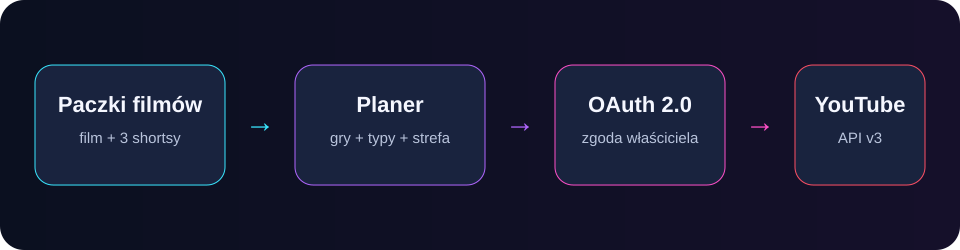

# Divithy YouTube Publisher

[](https://github.com/Divithy-IT/divithy-youtube-publisher/actions/workflows/checks.yml)


**Wydanie przygotowywane: 0.3.0-beta.1.** Instrukcja CLI i wymagania dla użytkowników: [Quick start (English)](docs/QUICKSTART_EN.md).

Lokalny publikator, który zamienia gotowe paczki filmów w uporządkowany
harmonogram kanału YouTube. Obsługuje tytuły, opisy, tagi, miniatury,
playlisty, Shortsy, filmy główne i planowane daty publikacji.



## Czym to jest, a czym nie jest

To **drugi etap** dwuczęściowego łańcucha produkcyjnego kanału Divithyツ.
Materiał powstaje w
[divithy-highlight-lab](https://github.com/Divithy-IT/divithy-highlight-lab),
a to narzędzie zajmuje się wszystkim, co dzieje się od gotowego pliku wzwyż:
walidacją paczki, metadanymi, playlistami, kolejnością i wysyłką. Oba
repozytoria stykają się na katalogu gotowych paczek i nie dublują swoich zadań.

Repozytorium przechowuje **publiczny kod i dokumentację**. Nie jest pełną kopią
roboczego środowiska: nie zawiera wszystkich lokalnych narzędzi operacyjnych,
tokenów OAuth, rejestrów uploadu, prywatnego harmonogramu, napisów ani nagrań.
Do odtworzenia kolejki po awarii potrzebna jest osobna prywatna kopia stanów,
manifestów i zatwierdzonych assetów. Nie wolno odtwarzać kolejki samym ponownym
uploadem plików — najpierw trzeba uzgodnić istniejące identyfikatory YouTube.

## Najważniejsze możliwości

- pięciodniowy rytm „film główny najpierw”: odcinki w dniach 1 i 3 o 15:00,
  a po nich po trzy powiązane Shortsy;
- naprzemienna kolejka gier, np. `L4D2 → PUBG → L4D2`;
- przeplatanie kompilacji i pełnych rozgrywek wewnątrz każdej gry;
- wyszukiwanie istniejących playlist i tworzenie brakujących;
- podgląd całego planu przed wysłaniem czegokolwiek;
- wznowienie po przerwaniu bez ponownego wysyłania gotowych pozycji;
- aplikacja okienkowa oraz tryb CLI do automatyzacji.

## Szybki start na Windows

1. Pobierz repozytorium i uruchom `Instalacja.bat`.
2. Skopiuj `publisher_config.example.json` do `publisher_config.json`.
3. Ustaw `content_root`, datę startu i lokalną ścieżkę do klienta OAuth.
4. Uruchom `Uruchom_publikator.bat`.
5. Najpierw wybierz **Przygotuj podgląd**, a dopiero potem połącz konto.

Pełna instrukcja konfiguracji Google znajduje się w
[INSTRUKCJA_AUTORYZACJI.md](INSTRUKCJA_AUTORYZACJI.md).

## Układ paczki

```text
Filmy YouTube/
└── film5/
    ├── Divithy_L4D2_Odcinek_05.mp4
    ├── Short_01.mp4
    ├── Short_02.mp4
    ├── Short_03.mp4
    ├── Miniatura_05.jpg
    ├── YouTube_05.txt
    ├── gra.txt              # opcjonalnie: L4D2
    └── typ.txt              # kompilacja lub pelna_rozgrywka
```

Paczka pełnej rozgrywki może nie mieć Shortsów. Plik metadanych zawiera
sekcje `FILM GŁÓWNY` oraz, jeśli występują, `SHORT 1` do `SHORT 3`.

Domyślny cykl dwóch paczek:

- dzień 1: film A 15:00, Shorts A1 18:00;
- dzień 2: Shorts A2 18:00;
- dzień 3: film B 15:00, Shorts B1 18:00;
- dzień 4: Shorts B2 18:00;
- dzień 5: Shorts A3 15:00, Shorts B3 18:00.

Sloty Luźnej sceny (dzień 2, 15:00) i materiału poradnikowego (dzień 4,
15:00) są obsługiwane przez rozszerzony lokalny workflow kanału.

## Konfiguracja

### Zasady kanału i zakres kopii

Aktualne ustalenia produkcyjne i publikacyjne opisuje
[polityka projektu](docs/ZASADY_KANALU.txt), a limity pracy i reguły wznawiania
[ochrona budżetu](docs/ZASADY_BUDZETU.txt).
Są to zasady rozszerzonego procesu kanału, nie deklaracja, że każda z nich
jest już zaimplementowana w tym publicznym wydaniu aplikacji.

Najważniejsze pola w `publisher_config.json`:

| Pole | Znaczenie |
|---|---|
| `content_root` | katalog zawierający paczki `film5`, `film6` itd. |
| `start_date` | pierwszy dzień kolejki w formacie `RRRR-MM-DD` |
| `timezone` | strefa publikacji, domyślnie `Europe/Warsaw` |
| `game_order` | preferowana kolejność serii |
| `type_order` | kolejność kompilacji i pełnych rozgrywek |
| `playlist_names` | mapowanie gry na nazwę playlisty |
| `schedule_publication` | jawne włączenie planowanej publikacji publicznej; domyślnie `false` |
| `expected_channel_id` | identyfikator właściwego kanału, sprawdzany przed wysyłaniem |
| `default_language` | język metadanych filmów i playlist |
| `playlist_privacy` | prywatność nowo tworzonych playlist; domyślnie `private` |

## Bezpieczny przebieg

Podgląd planu niczego nie publikuje. Realne wysłanie wymaga osobnej zgody.
Stan ukończonych operacji trafia do ignorowanego pliku `upload_state.json`.
Sekrety klienta, tokeny OAuth, lokalna konfiguracja i filmy są blokowane przez
`.gitignore`.

CLI domyślnie pokazuje podgląd. Wysyłanie wymaga `--upload --approve-plan SHA256`
z zatwierdzonego planu. Najpierw sprawdź kanał przez `--check-channel` i ustaw
`expected_channel_id`. `schedule_publication: false` oznacza tylko prywatne
filmy; `true` ustawia przyszłe daty publicznej publikacji. Flaga `api_audited`
z dawnych konfiguracji jest ignorowana. Według [aktualizacji Google z 2 listopada
2026](https://developers.google.com/youtube/data/revision_history) nieaudytowane
projekty nie mają już ogólnej blokady filmów jako prywatnych.

Oba interfejsy zachowują zarezerwowane daty i blokują równoległą pracę z tym
samym stanem. Nieznany wynik uploadu zatrzymuje automatyczne ponawianie do czasu
uzgodnienia ID z YouTube Studio. Nie przenoś plików ani nie kasuj historii w celu
ponowienia wysyłania. [Instrukcja odzyskiwania](docs/QUICKSTART_EN.md#interrupted-operations).

## Testy i rozwój

```powershell
python -m venv .venv
.\.venv\Scripts\Activate.ps1
pip install -r requirements.txt
python -m unittest discover -s tests -v
```

Zasady współpracy opisuje [CONTRIBUTING.md](CONTRIBUTING.md), zmiany
[CHANGELOG.md](CHANGELOG.md), a zgłoszenia bezpieczeństwa
[SECURITY.md](SECURITY.md).

## Zgodność z YouTube API

Divithy Publisher używa Google OAuth 2.0 i YouTube Data API wyłącznie do
działań zleconych przez uprawnionego właściciela kanału. Obowiązują publiczna
[Polityka prywatności](PRIVACY.md) i [Regulamin](TERMS.md). Dostęp można
w każdej chwili cofnąć w
[połączeniach zewnętrznych konta Google](https://myaccount.google.com/connections).

## Licencja

[MIT](LICENSE) © 2026 Michał Lemanczyk.

---

## English

A local Python application that turns finished content packages into an
orderly YouTube publishing schedule. It validates packages and handles titles,
descriptions, tags, thumbnails, playlists, Shorts, main episodes and planned
publication dates through the YouTube Data API v3.

### What this is, and what it is not

This is the **second stage** of a two-part production chain for the Divithyツ
channel. The material itself is produced by
[divithy-highlight-lab](https://github.com/Divithy-IT/divithy-highlight-lab);
this tool takes over from the finished file onwards. The two repositories meet
at a directory of content packages and do not duplicate each other's work.

The repository holds public code and documentation. It is **not** a full copy of
the working environment: it excludes operational tooling, OAuth tokens, upload
registries, the private schedule, subtitles and footage. Recovering an
interrupted queue requires a separate private copy of state files, manifests and
approved assets. A queue must never be rebuilt by simply re-uploading files —
existing YouTube video IDs have to be reconciled first.

### Key features

- a five-day rhythm that publishes the main episode first, then its Shorts;
- an alternating game queue, for example `L4D2 → PUBG → L4D2`;
- compilations and full playthroughs interleaved within each game;
- existing playlists are reused and missing ones created;
- a full plan preview before anything is sent;
- resumable runs that never re-upload completed items;
- both a desktop window and a CLI mode for automation.

### Quick start

Run `Instalacja.bat`, copy `publisher_config.example.json` to
`publisher_config.json`, set `content_root`, the start date and the local path
to your OAuth client, then launch `Uruchom_publikator.bat`. Always choose
**Przygotuj podgląd** (prepare preview) before connecting the account. Google
setup is documented in [INSTRUKCJA_AUTORYZACJI.md](INSTRUKCJA_AUTORYZACJI.md).

A package is a directory holding the main video, zero or exactly three Shorts, a
thumbnail, a metadata text file and optional `gra.txt` / `typ.txt` markers
naming the game and the content type.

### Safety

The CLI defaults to offline preview. Actual sending requires
`--upload --approve-plan SHA256` matching the reviewed plan and an explicitly
configured `expected_channel_id`. `schedule_publication` defaults to false
(private-only uploads). Enabling it explicitly schedules future public
publication. The legacy `api_audited` setting is ignored; Google's
[2 November 2026 revision](https://developers.google.com/youtube/data/revision_history)
removed the general private-only restriction for unverified projects.

Both interfaces preserve reserved dates, protect the same state file with a
process lock, and stop for reconciliation after an upload of unknown outcome.
Completed video IDs are saved before thumbnail and playlist steps. Credentials
and state remain local and git-ignored. See [CLI setup and recovery](docs/QUICKSTART_EN.md).
A customer still needs local Python, their own Google project and OAuth consent.

### Tests

```powershell
python -m venv .venv
.\.venv\Scripts\Activate.ps1
pip install -r requirements.txt
python -m unittest discover -s tests -v
```

### YouTube API compliance

Divithy Publisher uses Google OAuth 2.0 and the YouTube Data API only for the
actions requested by the authorized channel owner. Review the public
[Privacy Policy](PRIVACY.md) and [Terms of Service](TERMS.md). Access can be
revoked at any time from
[Google Account third-party connections](https://myaccount.google.com/connections).

Issues and pull requests in English are welcome. Licensed under
[MIT](LICENSE) © 2026 Michał Lemanczyk.

## Agent skill / Agensi

The original [agent workflow](skills/divithy-youtube-publisher/SKILL.md) orchestrates
this local application. Build its text-only ZIP with `python tools/build_skill.py`.
It contains instructions, a workflow reference and the MIT licence; it does not
bundle the application, dependencies, media or credentials. Runtime setup is
an explicit prerequisite. Marketplace delivery and acceptance require a separate
review; a built ZIP is not proof of marketplace approval or live API validation.
